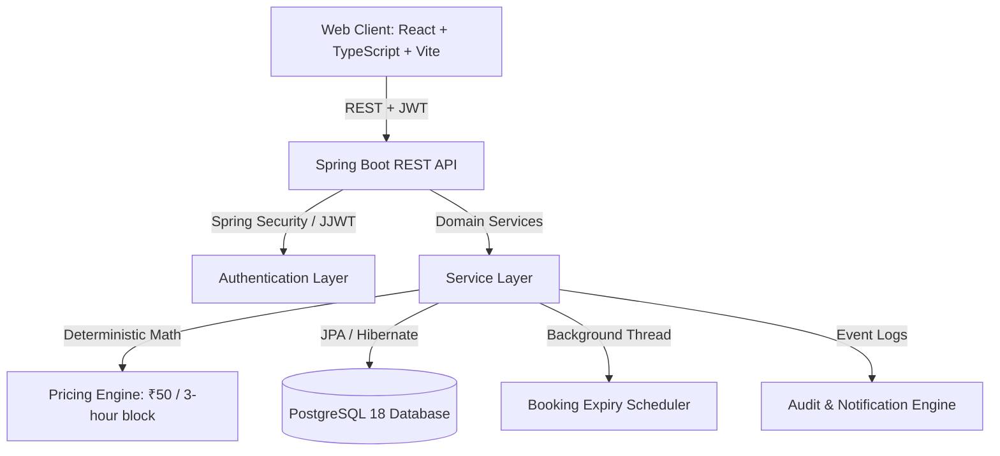
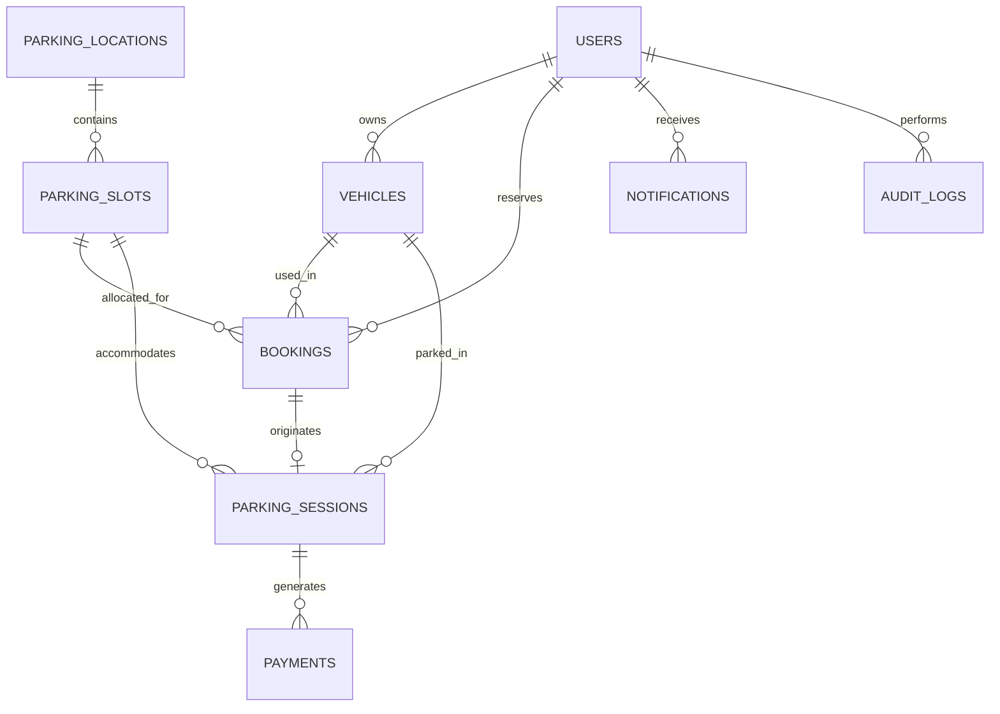

# SmartPark — System Architecture & Design Specification

## 1. System Overview

**SmartPark** is a full-stack, enterprise-grade automated parking reservation, gate management, and billing system. Designed for high-reliability commercial, airport, and municipal parking facilities, it automates the full vehicle lifecycle from online spot discovery and reservation to gate boom barrier QR check-in, real-time fee calculation, and payment settlement.

---

## 2. Technical Stack

| Tier | Technology | Purpose |
| :--- | :--- | :--- |
| **Frontend** | React 19, TypeScript, Vite 8, Vanilla CSS | Interactive 2D slot map, live session cost ticker, digital QR ticket pass, admin analytics |
| **Backend** | Spring Boot 3.3.4, Java 21 LTS | REST API, security filtering, transactions, scheduling |
| **Database** | PostgreSQL 18.6 | Relational data persistence with strict CHECK constraints & foreign keys |
| **Migration** | Flyway 10.x | Version-controlled schema migrations (`V1__initial_schema.sql`, `V2__seed_data.sql`) |
| **Security** | Spring Security 6, JJWT 0.12.x, BCrypt | Stateless JWT Bearer token authentication & role-based authorization |
| **Documentation** | SpringDoc OpenAPI 3 / Swagger UI | Interactive REST API explorer |

---

## 3. Database Schema & Entity Relationships

### Key Tables
1. **`users`**: User identity, role (`ADMIN`, `OPERATOR`, `CUSTOMER`), and `account_status`.
2. **`parking_locations`**: Physical facilities (e.g. Central Business Hub, Airport Terminal 2).
3. **`parking_slots`**: Individual bays with slot number, type (`CAR`, `MOTORCYCLE`, `EV`, `ACCESSIBLE`), status, floor, and optimistic lock version.
4. **`vehicles`**: License plates and vehicle types linked to user owners.
5. **`bookings`**: Pre-booked slots with start/end timestamps, unique booking reference (`SP-XXXX`), and gate QR security token.
6. **`parking_sessions`**: Physical parking occupancy from gate entry to exit checkout, tracking applied rate and final total bill.
7. **`payments`**: Simulated payment settlements (`UPI`, `CARD`, `CASH`) with transaction reference.
8. **`notifications`**: User alerts and ticket lifecycle notifications.
9. **`audit_logs`**: Administrative audit trail tracking actors, actions, and metadata.

---

## 4. Deterministic Fee Calculation Engine

The billing engine follows a strict, deterministic rule:

$$\text{fee} = 50.00 \times \left\lceil \frac{\text{duration\_seconds}}{10800} \right\rceil$$

### Rules & Boundary Conditions
- **Zero Duration**: Identical entry and exit timestamp returns exactly $\text{₹}0.00$.
- **Negative Duration**: Rejected with HTTP 400 (`BadRequestException`).
- **Partial Blocks**: Any fraction of a 3-hour (10,800s) interval rounds up to the next full block:
  - 1 second to 3 hours (10,800s) = **₹50.00** (1 block)
  - 3 hours 1 second to 6 hours (21,600s) = **₹100.00** (2 blocks)
  - 6 hours 1 second to 9 hours = **₹150.00** (3 blocks)
- **Currency Arithmetic**: Implemented strictly with `java.math.BigDecimal` to eliminate floating-point precision loss.

---

## 5. Security & Authentication Model

- **JWT Tokens**: Signed using HMAC-SHA512 with a minimum 256-bit secret key, carrying user ID, email, and role.
- **Role-Based Access Control**:
  - `CUSTOMER`: Can browse available slots, book spots, view own passes & sessions, pay bills.
  - `OPERATOR`: Can scan gate QR codes, authorize entry, view active parked sessions, and process checkout.
  - `ADMIN`: Full access including user governance, pricing rules, slot inventory, and financial audit reports.
